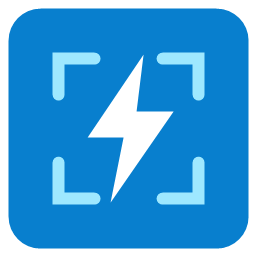

# Minha Captura

Aplicativo Windows em C# / .NET 10, sem pacotes externos e sem chamadas de rede no código do aplicativo.



Versão **0.1.0**, experimental. Projeto independente, sem vínculo com o Lightshot.

## Usar a release

Baixe `MinhaCaptura-v0.1.0-win-x64.zip` na seção Releases do repositório, extraia e execute `MinhaCaptura.exe`. Essa distribuição inclui o runtime e não exige instalar o .NET. Destinada a Windows x64 compatível com .NET 10. O aplicativo ainda não possui assinatura digital.

## Executar

Instale o SDK .NET 10 para Windows e execute `dotnet run` nesta pasta.

O aplicativo inicia na bandeja de ícones ao lado do relógio, sem janela principal. O Windows pode colocar o ícone no menu de ícones ocultos. Pressione **Print Screen** para capturar ou use **Nova captura** no menu do ícone. Um clique duplo no ícone também inicia a captura. Para encerrar o aplicativo e liberar o atalho, use **Sair** no menu.

Arraste para selecionar uma área (inclusive em vários monitores) e solte. Esc cancela a seleção. No editor, escolha seta, retângulo, caneta ou texto. Use **Cor**, **Desfazer**, **Copiar** ou **Salvar PNG**. A imagem é exibida em tamanho original, com barras de rolagem quando necessário. Fechar o editor mantém o aplicativo na bandeja. Durante a seleção ou edição, novas solicitações de captura são ignoradas.

Se outro aplicativo já tiver registrado Print Screen, uma notificação informa o conflito. Feche esse aplicativo e reinicie Minha Captura. Se a tecla abrir a Ferramenta de Captura do Windows, desative a opção de usar Print Screen para captura em **Configurações > Acessibilidade > Teclado** e reinicie Minha Captura. O aplicativo não altera essa configuração. Apenas uma instância do aplicativo é permitida por sessão.

As capturas ficam em memória até você salvar ou copiar; o aplicativo não envia imagens para servidores. Copiar utiliza a área de transferência do Windows, cujas configurações de histórico e sincronização são controladas pelo sistema.

Esta versão ainda não inclui recorte posterior ou desfoque. Telas protegidas e a área de trabalho segura do Windows podem não permitir captura.

## Configurar o atalho

Clique com o botão direito no ícone da bandeja e escolha **Configurações…**. Marque os modificadores desejados (**Ctrl**, **Alt**, **Shift**, **Win**) e escolha a tecla na lista. Por exemplo, Ctrl + Shift + S. Clique em **Salvar** para aplicar imediatamente. **Cancelar** descarta a alteração; **Padrão: Print Screen** prepara o atalho original para ser salvo.

Se o Windows não permitir registrar a combinação, a janela informa o problema e mantém o atalho anterior. A preferência é salva em `%LOCALAPPDATA%\MinhaCaptura\settings.json` e recuperada na próxima abertura. Durante a configuração, capturas pelo atalho ficam temporariamente suspensas.

## Compilar o executável

`dotnet build -c Release`

O executável fica em `bin/Release/net10.0-windows/` e requer o .NET Desktop Runtime 10.

Para gerar o ZIP independente do runtime, com licença e checksum SHA-256:

```powershell
powershell -ExecutionPolicy Bypass -File tools/Release.ps1
```

Os arquivos são gerados em `artifacts/`, ignorada pelo Git. A primeira publicação pode baixar os componentes do runtime pelo NuGet.

## Contribuir e licença

Relate problemas e sugestões nas Issues do repositório. Para mudanças no código, descreva o comportamento alterado e como verificou a alteração. Veja o [histórico de versões](CHANGELOG.md).

Código e ícone próprio disponíveis sob a [licença MIT](LICENSE).
